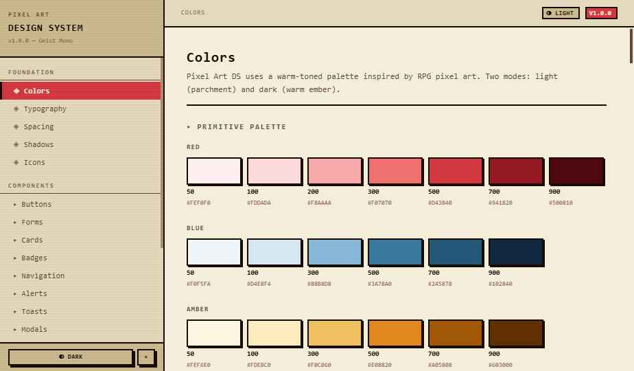

# Pixel Art Design System

> An accessibility-focused design system playground that brings a disciplined pixel-art language to web interfaces.

[](LICENSE)
[](https://github.com/efesodavila/pixel-art-ds/actions/workflows/ci.yml)
[](#accessibility)



Pixel Art Design System explores how a retro visual language can coexist with modern design-system discipline: semantic tokens, light and dark themes, keyboard-friendly components, and automated contrast checks.

This repository is currently a browser-first showcase and documentation playground. The npm package surface is intentionally planned for a future release; the source is not presented as an installable package yet.

## Highlights

- 60+ pixel-art components across foundations, forms, navigation, overlays, data display, and game UI.
- Three-layer design tokens: primitive, semantic, and component-level decisions.
- Light and dark themes with a WCAG contrast gate for key semantic pairs.
- Live documentation with theme customization, token exports, and an accessibility audit page.
- React Native-friendly token helpers, while visual components remain web-focused for now.
- No bundler required for the showcase: the docs run from a static server.

## Quick start

Requirements: Node.js 18 or newer.

```bash
git clone https://github.com/efesodavila/pixel-art-ds.git
cd pixel-art-ds
npm install
npm run dev
```

Open the local URL printed by `serve`. The documentation site loads the React and Babel browser builds from their pinned CDN URLs.

To run the validation checks directly:

```bash
npm run tokens:validate
npm run tokens:check-contrast
```

## Repository map

```text
pixel-art-ds/
├── index.html              # Static documentation entry point
├── src/                    # Showcase pages and browser components
├── tokens/
│   ├── tokens.json         # Design-token source of truth
│   ├── tokens.css          # CSS custom properties
│   └── tokens.js           # JavaScript / React Native helpers
├── docs/                   # Architecture, accessibility, theming, and ADRs
├── screenshots/            # Project previews
├── scripts/                # Token and contrast validation
└── .github/                # CI, issue templates, and contribution workflow
```

## Accessibility

The project treats accessibility as a design constraint rather than a post-processing step.

- Body text starts at 14px in the semantic type scale.
- Focus indicators, keyboard interaction, target sizes, and reduced motion are documented and represented in the showcase.
- `tokens/tokens.json` is validated by CI.
- `scripts/check-contrast.js` checks the core text, interactive, and non-text contrast pairs in both themes.

See [docs/ACCESSIBILITY.md](docs/ACCESSIBILITY.md) for the implementation notes and audit scope. The automated gate covers the token system; it does not replace manual testing with assistive technology.

## Design tokens

The source of truth is [`tokens/tokens.json`](tokens/tokens.json). The same decisions are mirrored into:

- [`tokens/tokens.css`](tokens/tokens.css) for web custom properties;
- [`tokens/tokens.js`](tokens/tokens.js) for JavaScript and React Native-friendly helpers.

When changing tokens, run both validation commands and update the relevant documentation.

## Roadmap

- Publish a properly bundled npm package for web consumers.
- Add Storybook stories and component-level tests.
- Add visual regression coverage with Playwright and pixel matching.
- Improve TypeScript declarations and React Native component parity.
- Add RTL and internationalization examples.

## Contributing

Issues and pull requests are welcome. Start with [CONTRIBUTING.md](CONTRIBUTING.md), review the component checklist, and run the validation scripts before opening a pull request.

## License

Released under the [MIT License](LICENSE).

## Credits

- Typography: [Geist Mono](https://vercel.com/font) by Vercel.
- Inspiration: PICO-8, Game Boy, NES/SNES UI conventions, Apple HIG, Material 3, and Radix UI.
- Token format: [W3C Design Tokens Community Group](https://www.w3.org/community/design-tokens/).
